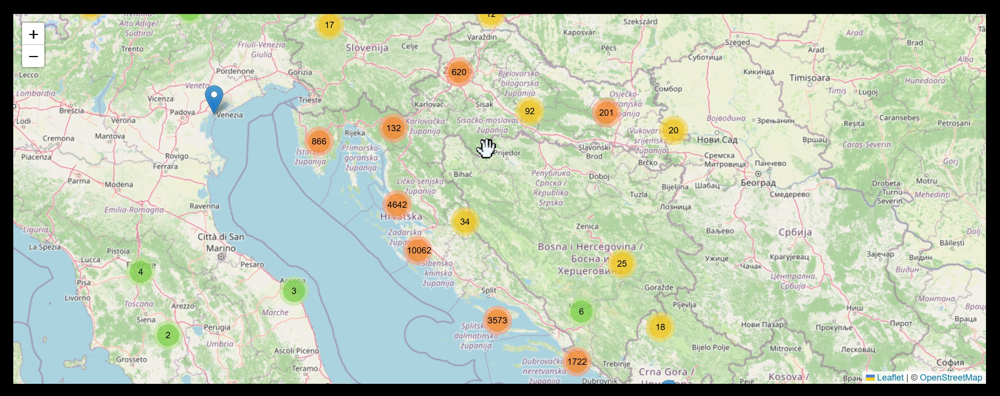

# _vweb
## Relenvantno znanje i vještine koje sam stekao radeæi na projektima

### Svrha:
---
Brzo i jednostavno predoèiti sve od znaèaja što sam napravio

### Zadatak: klijent je tražio da mu se slike prikažu na geografskoj lokaciji Zemlje tamo gdje su i slikane.
#### Razrada: 
-------
Za svrhu prikaza "street view" Zemlje pronašao sam besplatni vanjski servis [Open Street Map](https://www.openstreetmap.org/) koji mi omoguæava prikazivanje "tile-ova" na stranici. 

Zatim za postavljanje slika na mapi sam koristio besplatni plugin [Leaflet](https://leafletjs.com/). 

Koristio sam još i besplatni plugin [marker cluster](https://github.com/leaflet/leaflet.markercluster) koji se gradi nad leaflet pluginu koji automatski grupira preklapajuæe oznake (markere) u jednu zajednièku ikonu s brojem stavki kako bi poboljšao performanse i èitljivost karte.

#### Realizacija
-------
Kako se prikaz tile-ova zatraži nakon uèitavanja stranice postoje dvije opcije koje treba uzeti u obzir.

Opcija 1: Sa PHP-om generirati javascript kod za umetanje svake pojedine slike koji æe se izvršiti kada se obradi onLoad event.

Nus pojave: èeka se preko 5 sekundi prije nego što korisnik dobije stranicu nazad od servera jer treba obraditi 27000+ slika. Tu je takoðer problem i nepotrebnog trošenja bandwidth-a mreže jer je stranica velika 30+ kB umjesto par stotina bajtova.

---

Opcija 2: Poslati "praznu" stranicu korisniku i pomoæu ajax GET zahtjeva dohvatiti potrebne podatke. (id, longitude, latitude, naziv)

Analiza: riješili smo nus pojave iz prothodne opcija, ali sada kada se mapa odmah uèita èekamo 5 sekunda na zamrznutoj stranici jer je main thread optereæen uèitavanjem slika.
Kako bih riješio ovaj problem koristio sam built-in funkciju setTimeout kako bih podijelio posao na ostatak procesora. Poboljšao se i user experience jer je sada animirano uèitavanje markera u klustere umjesto da se sve uèita u jedan trenutak.

Dodatno sam optimizirao bandwidth jer nepotrebno ne dohvaæam SVE nazive slika napoèetku, veæ samo naziv slike nakon što klikneš na nju odnosno klikneš na kluster.

---

#### Demonstracija:
---
Slika prikazuje inicijalno stanje nakon što uèita sve slike iz baze.

Slika prikazuje inicijalno stanje nakon što uèita sve slike iz baze i zoom-ira se mapa.

Slika prikazuje otvorenu mini galeriju kliknutog klustera.

### U izradi...
Moram ukloniti copyright sadrzaj prije nego sto prezentiram svoj rad.